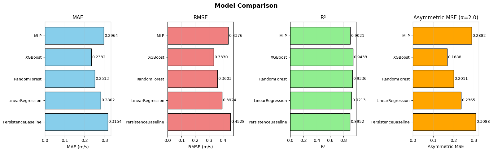

# Short-Term Wind Speed Forecasting at Tehachapi, CA

Next-hour wind speed prediction for the Tehachapi Pass wind resource area in California, one of the largest wind farm clusters in the state, using three years of hourly ERA5 reanalysis data. Final project for **CIS 5200 (Machine Learning)** at the University of Pennsylvania, by [Michel Faloughi](https://github.com/MichelFaloughi), [Alfred Hofmann](https://github.com/alfredpmhofmann), and [Gaoxiang Zhao](https://github.com/seerier).

📄 **[Read the full project report (PDF)](report/CIS5200_Final_Report.pdf)**: data pipeline, model descriptions, the asymmetric loss, and calibration analysis.


*All learned models beat the persistence baseline; XGBoost performs best overall (RMSE 0.333 m/s, R² 0.943, vs. 0.453 m/s and 0.895 for persistence).*

## Overview

Accurate short-term wind forecasts matter for grid operation and renewable integration, and wind speed is a hard target: strong diurnal cycles combined with rapid, chaotic short-term variability. We frame the problem as supervised regression: predict the next hour's wind speed at the Tehachapi site (35.04° N, 118.26° W) from ERA5 surface variables (10 m wind components, 2 m temperature, surface pressure), lagged wind speeds, and cyclical time encodings.

Two ideas beyond the standard setup:

- **Asymmetric loss.** Underpredicting wind is operationally more costly than overpredicting it, so alongside MSE we evaluate with an asymmetric MSE that penalizes underprediction more heavily (α = 2).
- **Post-hoc affine calibration.** All models systematically underpredict high winds; a simple affine correction fit on validation data reduces this bias across the board.

## Models

A ladder from trivial baseline to deep learning, all exposing the same `fit()` / `predict()` interface through `models.registry.get_model(...)`:

| Model | Description |
|-------|-------------|
| `model0` PersistenceBaseline | Predicts the last observed wind speed; the bar every other model must clear |
| `model1` LinearRegression | Scaled linear model over all engineered features, with interpretable coefficients |
| `model2` RandomForest | Bagged tree ensemble capturing nonlinear interactions |
| `model3` XGBoost | Gradient boosting over 24-hour lag windows of key meteorological variables; the strongest model |
| `model4` MLP | Feed-forward network on the same feature view (tuning study in `eval/MLP-Tuning.ipynb`) |
| `model5` Transformer | PyTorch encoder-only transformer with positional encoding, checkpointing, and early stopping |

## Repository layout

| Path | Contents |
|------|----------|
| `models/` | One module per model, plus `registry.py` (model factory) and `custom_loss.py` (asymmetric loss) |
| `models/notebooks/` | Development notebooks for the individual models |
| `models/artifacts/` | Trained transformer checkpoint |
| `data/` | ERA5 download notebook for the Tehachapi site and feature engineering helpers |
| `eval/` | Unified evaluation notebook, metric helpers, transform pipeline, and the MLP tuning study |
| `tutorials/` | ERA5 / CDS API walkthrough |
| `Images/` | Result figures used in the report and this README |
| `report/` | The full project report (PDF) |

## Getting started

```bash
git clone https://github.com/MichelFaloughi/cis5200-project.git
cd cis5200-project
pip install -r requirements.txt
```

The data pipeline pulls ERA5 from the Copernicus Climate Data Store, which requires a free [CDS account](https://cds.climate.copernicus.eu/) and an API key in `~/.cdsapirc`:

```
url: https://cds.climate.copernicus.eu/api
key: <your API key>
```

Then run `data/downloading_tehachapi_data.ipynb` to build the dataset and `eval/eval.ipynb` to train and compare the models.

## License

[MIT](LICENSE)
